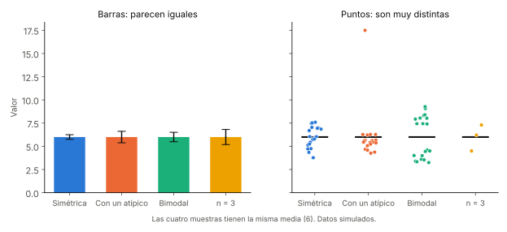

# Capítulo 2. Describir y visualizar {#sec-cap2}

::: {.callout-note appearance="default"}
## Objetivos
- Resumir variables con medidas de centro y de dispersión adecuadas a su forma.
- Elegir gráficos que muestren los datos, no solo sus medias.
- Detectar valores atípicos, asimetrías y errores antes de cualquier contraste.
:::

::: {.callout-note appearance="simple" icon="false"}
## Glosario del capítulo
[Media y mediana](92-glosario.qmd#gl-media) · [Desviación típica](92-glosario.qmd#gl-desviacion) · [Rango intercuartílico](92-glosario.qmd#gl-iqr) · [Valor atípico](92-glosario.qmd#gl-atipico) · [Correlación](92-glosario.qmd#gl-correlacion)
:::

::: {.callout-tip appearance="simple" icon="false"}
## Descargas
[Script R del capítulo](plantillas/02_describir.R){.btn .btn-outline-primary .btn-sm download="02_describir.R"}
[Datos del libro (CSV)](datos/estudio.csv){.btn .btn-outline-primary .btn-sm download="estudio.csv"}
[Plantilla de entrega del reto (.qmd)](plantillas/entrega_reto.qmd){.btn .btn-outline-primary .btn-sm download="entrega_reto.qmd"}
:::

## Lectura obligatoria

::: {.lectura}
Weissgerber, T. L.; Milic, N. M.; Winham, S. J.; Garovic, V. D. (2015). [Beyond bar and line graphs: Time for a new data presentation paradigm](https://doi.org/10.1371/journal.pbio.1002128). *PLOS Biology*, 13(4), e1002128.
:::

## 1. Centro y dispersión

| Medida | Qué resume | Cuándo usarla |
|---|---|---|
| **Media** | Valor «de equilibrio» | Distribuciones aproximadamente simétricas |
| **Mediana** | Valor central | Distribuciones asimétricas o con atípicos |
| **Desviación típica** | Distancia típica a la media | Junto a la media |
| **Rango intercuartílico** (IQR) | Amplitud del 50 % central | Junto a la mediana |

```{webr}
#| autorun: true
d <- read.csv("datos/estudio.csv")
summary(d$nota)
c(media = mean(d$nota), desv_tipica = sd(d$nota), IQR = IQR(d$nota))
tapply(d$nota, d$grupo, median)   # mediana por grupo
```

## 2. Mostrar los datos, no solo las medias

@weissgerber2015 revisaron artículos de fisiología y encontraron que la mayoría presentaba datos continuos con **gráficos de barras** de medias. El problema: distribuciones muy distintas (con atípicos, bimodales, con pocos datos) producen la misma barra. Recomiendan **gráficos que muestren cada observación** (diagramas de puntos o de dispersión) o, con muchos datos, **diagramas de caja** o de violín.

{#fig-c2-barras fig-alt="A la izquierda, cuatro barras de igual altura con barras de error. A la derecha, los puntos de las mismas cuatro muestras: una simétrica, otra con un valor atípico muy alto, otra bimodal y otra con solo tres observaciones."}

```{webr}
#| autorun: true
#| fig-height: 4
d <- read.csv("datos/estudio.csv")
stripchart(nota ~ grupo, data = d, vertical = TRUE, method = "jitter", pch = 19,
           col = c("#eb6834", "#2a78d6"), ylab = "Nota", main = "Cada punto, una persona")
boxplot(nota ~ grupo, data = d, add = TRUE, outline = FALSE, col = NA, border = "grey40")
```

## 3. Relaciones entre dos variables

La **correlación de Pearson** (*r*) mide la fuerza de una relación **lineal** entre −1 y 1. No mide relaciones curvas, es sensible a atípicos y no implica causalidad. Antes de calcularla, **dibuja** el diagrama de dispersión.

```{webr}
#| autorun: true
#| fig-height: 4
d <- read.csv("datos/estudio.csv")
plot(d$horas, d$nota, pch = 19, col = "#2a78d6", xlab = "Horas de estudio a la semana", ylab = "Nota")
cor(d$horas, d$nota)
```

## Laboratorio: el mismo resumen, datos distintos {#lab-c2-cuarteto}

::: {.laboratorio}
::: {.laboratorio-etiqueta}
Laboratorio · se ejecuta en tu navegador
:::

El **cuarteto de Anscombe** (1973) son cuatro conjuntos de datos con la misma media, la misma varianza y la misma correlación (*r* ≈ 0,82). Elige uno y mira el gráfico.

```{ojs}
//| echo: false
seleccion = window.Lab.seleccion
anscombe = ({
  x: [10, 8, 13, 9, 11, 14, 6, 4, 12, 7, 5], x4: [8, 8, 8, 8, 8, 8, 8, 19, 8, 8, 8],
  y1: [8.04, 6.95, 7.58, 8.81, 8.33, 9.96, 7.24, 4.26, 10.84, 4.82, 5.68],
  y2: [9.14, 8.14, 8.74, 8.77, 9.26, 8.10, 6.13, 3.10, 9.13, 7.26, 4.74],
  y3: [7.46, 6.77, 12.74, 7.11, 7.81, 8.84, 6.08, 5.39, 8.15, 6.42, 5.73],
  y4: [6.58, 5.76, 7.71, 8.84, 8.47, 7.04, 5.25, 12.50, 5.56, 7.91, 6.89]})
viewof conjunto = seleccion("Conjunto", [["1", "I: relación lineal con ruido"], ["2", "II: relación curva"], ["3", "III: lineal con un atípico"], ["4", "IV: un solo punto palanca"]], {value: "1"})
```

```{ojs}
//| echo: false
{
  const k = +conjunto, xs = k === 4 ? anscombe.x4 : anscombe.x, ys = anscombe["y" + k];
  const n = xs.length, mx = xs.reduce((a, b) => a + b) / n, my = ys.reduce((a, b) => a + b) / n;
  const sxy = xs.reduce((s, x, i) => s + (x - mx) * (ys[i] - my), 0), sxx = xs.reduce((s, x) => s + (x - mx) ** 2, 0), syy = ys.reduce((s, y) => s + (y - my) ** 2, 0);
  const r = sxy / Math.sqrt(sxx * syy), b = sxy / sxx, a = my - b * mx;
  const X = x => 40 + (x - 3) * 26, Y = y => 220 - (y - 2) * 16;
  const pts = xs.map((x, i) => `<circle cx="${X(x)}" cy="${Y(ys[i])}" r="5" fill="#2a78d6"/>`).join("");
  const f = v => v.toFixed(2).replace(".", ",");
  const d = html`<div role="status"></div>`;
  d.innerHTML = `<p>Media de x = ${f(mx)} · media de y = ${f(my)} · <em>r</em> = ${f(r)} · recta: y = ${f(a)} + ${f(b)}·x</p>
   <svg viewBox="0 0 480 240" width="100%" style="max-width:480px" role="img" aria-label="Diagrama de dispersión del conjunto ${k} de Anscombe con su recta de regresión">
   <line x1="40" y1="220" x2="470" y2="220" stroke="currentColor" stroke-opacity=".4"/><line x1="40" y1="10" x2="40" y2="220" stroke="currentColor" stroke-opacity=".4"/>
   <line x1="${X(3)}" y1="${Y(a + b * 3)}" x2="${X(19.5)}" y2="${Y(a + b * 19.5)}" stroke="#eb6834" stroke-width="2"/>${pts}</svg>
   <p class="small">Los cuatro resúmenes son casi idénticos; los gráficos no. Moraleja: dibuja siempre antes de resumir.</p>`;
  return d;
}
```
:::

### Ejercicio 2.1 {.unnumbered}

Calcula la **mediana** de las horas de estudio de cada grupo.

```{webr}
#| exercise: c2_med
#| setup: true
d <- read.csv("datos/estudio.csv")
```

```{webr}
#| exercise: c2_med
tapply(d$horas, d$grupo, ______)
```

::: {.hint exercise="c2_med"}
`tapply(variable, grupo, función)` aplica la función a cada grupo; la función es `median`.
:::

::: {.solution exercise="c2_med"}
```r
tapply(d$horas, d$grupo, median)
```
:::

```{webr}
#| exercise: c2_med
#| check: true
dd <- read.csv("datos/estudio.csv"); esperado <- tapply(dd$horas, dd$grupo, median)
if (isTRUE(all.equal(as.numeric(.result), as.numeric(esperado)))) list(correct = TRUE, message = "Correcto.") else
  list(correct = FALSE, message = "Usa median como tercer argumento de tapply().")
```

### Ejercicio 2.2 {.unnumbered}

Calcula la correlación entre **ansiedad** y **sueño**. ¿Es positiva o negativa?

```{webr}
#| exercise: c2_cor
#| setup: true
d <- read.csv("datos/estudio.csv")
```

```{webr}
#| exercise: c2_cor
cor(d$ansiedad, d$______)
```

::: {.hint exercise="c2_cor"}
La columna del sueño se llama `sueno` (sin eñe).
:::

::: {.solution exercise="c2_cor"}
```r
cor(d$ansiedad, d$sueno)
```
Negativa: en estos datos simulados, quienes duermen más tienden a tener menos ansiedad. Es una asociación, no una prueba de causalidad.
:::

```{webr}
#| exercise: c2_cor
#| check: true
dd <- read.csv("datos/estudio.csv")
if (isTRUE(all.equal(as.numeric(.result), cor(dd$ansiedad, dd$sueno)))) list(correct = TRUE, message = "Correcto: correlación negativa.") else
  list(correct = FALSE, message = "Usa la columna sueno.")
```

## Caso práctico resuelto

::: {.callout-note appearance="simple" icon="false"}
## Describir una variable asimétrica
Las citas de un grupo de 20 artículos: 0, 0, 1, 1, 2, 2, 3, 3, 4, 4, 5, 5, 6, 6, 7, 8, 9, 10, 12, 140.

- **Media:** 11,4. **Mediana:** 4,5. La media se dispara por un solo artículo.
- **Desviación típica** muy alta; el **rango intercuartílico** (de 2 a 7,5) describe mejor la dispersión típica.
- **Gráfico:** un histograma o un diagrama de caja muestra la asimetría y el valor atípico; un gráfico de barras con la media lo ocultaría.

Regla práctica: con distribuciones asimétricas, informa de la **mediana y el rango intercuartílico**, y muestra los datos.
:::

## Ejercicios graduados

**Básico.** ¿Qué medida de tendencia central usarías para los ingresos de una población? ¿Por qué?

::: {.webex-solution boton="Ver solución"}
La mediana: los ingresos son muy asimétricos y unos pocos valores muy altos elevan la media.
:::

**Avanzado.** Con el conjunto `estudio.csv` del libro, describe la variable `horas` con medidas y un gráfico adecuados y justifica la elección.

::: {.webex-solution boton="Ver solución"}
Comprueba primero la forma de la distribución; si es aproximadamente simétrica, media y desviación típica son adecuadas; si no, mediana y rango intercuartílico. El gráfico debe mostrar la distribución, no solo un resumen.
:::


## Actividades

::: {.clasificar #ia-c2-resumen titulo="¿Media o mediana?" categorias="Media|Mediana"}
- Ingresos de los hogares de un barrio → Mediana // Muy asimétricos.
- Altura de un grupo de personas adultas → Media
- Número de citas de los artículos de un departamento → Mediana
- Temperatura media diaria de un mes → Media
- Tiempo hasta terminar la tesis, con algunos casos muy largos → Mediana
:::

::: {.clasificar #ia-c2-grafico titulo="¿Qué gráfico usarías?" categorias="Diagrama de puntos o de caja|Diagrama de dispersión|Histograma|Barras de frecuencias"}
- Comparar la nota de dos grupos de 15 personas → Diagrama de puntos o de caja
- Ver la relación entre horas de estudio y nota → Diagrama de dispersión
- Ver la forma de la distribución de 5000 tiempos de respuesta → Histograma
- Mostrar cuántos doctorandos hay en cada rama → Barras de frecuencias
:::

## Reto evaluable {#reto-c2}

::: {.callout-important appearance="simple" icon="false"}
## Reto del capítulo 2 · Rehacer una figura
1. Busca en tu campo un artículo que presente datos continuos con un **gráfico de barras** de medias.
2. Explica qué información oculta (tamaño de la muestra, distribución, atípicos).
3. Con los datos del libro (o con datos tuyos), crea en R una figura que muestre **cada observación** y escribe un pie de figura completo y autosuficiente.
4. Añade una tabla descriptiva con las medidas de centro y dispersión adecuadas.

**Entrega:** con la [plantilla de entrega](plantillas/entrega_reto.qmd). Este reto **no tiene solución en el libro**.
:::

## Autoevaluación

Responde a todas las preguntas y pulsa **Mostrar respuestas**. No cuenta para la nota.

::: {.webex-check .webex-box}
1. Con una distribución muy asimétrica, la mediana describe mejor el valor típico que la media. 
2. La medida de dispersión que acompaña a la mediana es el rango 
3. Una correlación de Pearson igual a 0 significa que no hay ninguna relación entre las variables. 
4. Según @weissgerber2015, para datos continuos con muestras pequeñas conviene usar 
5. Los cuatro conjuntos del cuarteto de Anscombe tienen 
6. `tapply(d$nota, d$grupo, mean)` calcula 
7. La correlación de Pearson mide la fuerza de una relación 
8. ¿Qué debes hacer antes de calcular una correlación?


:::

::: {.webex-solution boton="Ver explicaciones"}
- La media se deja arrastrar por los extremos.
- IQR: percentil 75 menos percentil 25.
- Puede haber una relación curva fuerte con *r* ≈ 0.
- Puntos individuales, cajas o violines.
- Esa es su lección.
- Una media por grupo.
- Solo lineal.
- Y no eliminar atípicos sin justificarlo.
:::
